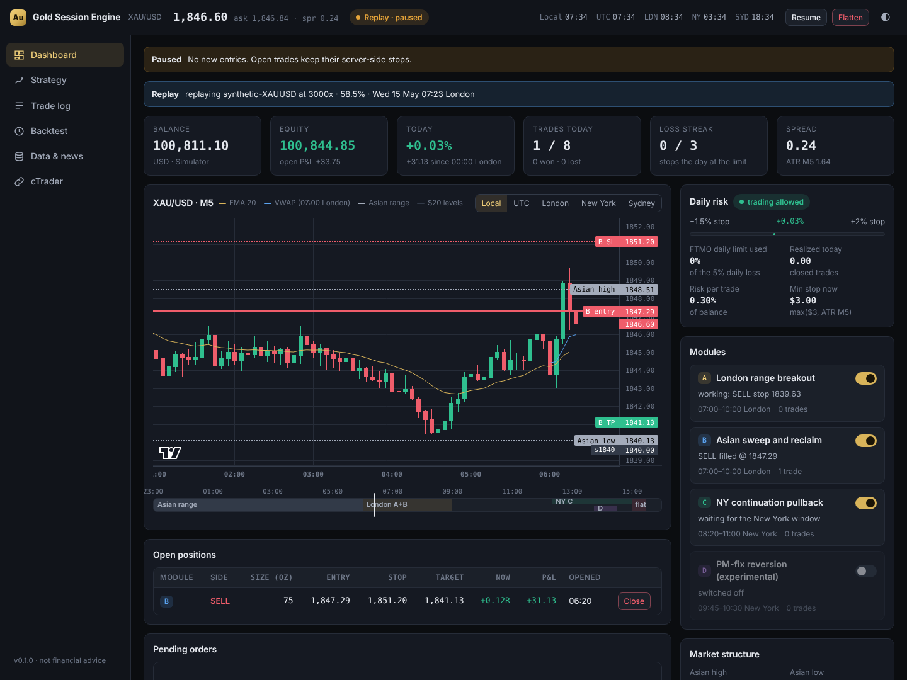
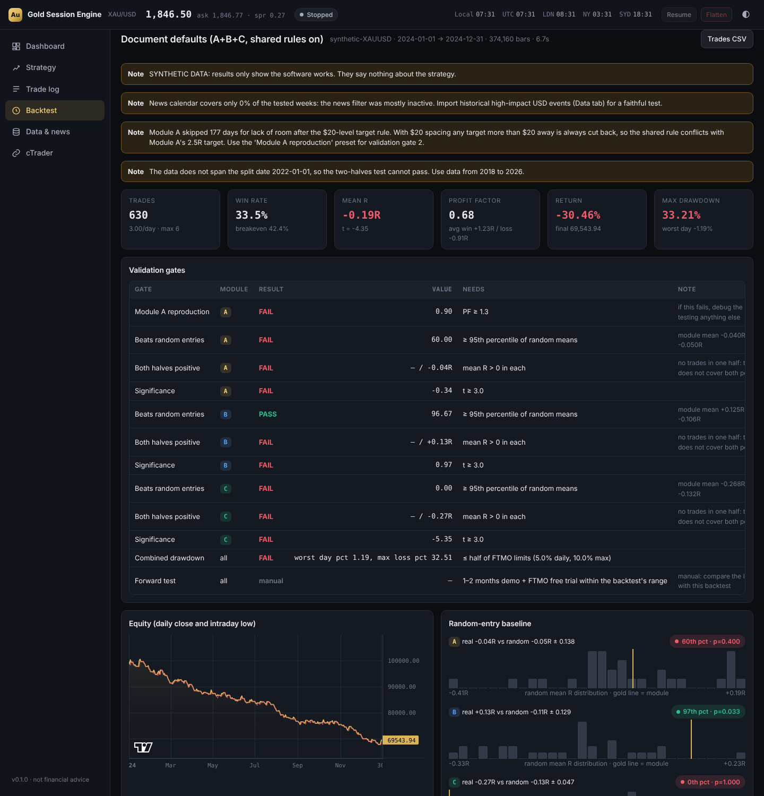

# Gold Session Engine

An XAU/USD intraday bot for the **cTrader Open API**, built from the *Gold Session Engine* strategy document. It comes with a web **terminal** where you can watch the strategy, follow the connected cTrader account, read the trade log and run backtests.



> Research software, not financial advice. Nothing here is proven until it passes the validation plan. Start in **paper** mode.

## What's inside

| Part | What it does |
| --- | --- |
| **Strategy engine** (`gse/engine.py`, `gse/modules/`) | The four modules (A London breakout, B Asian sweep and reclaim, C NY pullback, D PM-fix reversion, off by default) and every shared rule: 0.3% risk sized from money at the stop, 8 trades/day cap, −1.5% / 3-loss / +2% daily stops, $20-level stop and target placement, 1.2R minimum room, news blackout, no trades after 11:00 NY, flat by 11:30 NY, one direction at a time. **The same code runs in backtests, replays, paper and live trading.** |
| **cTrader Open API** (`gse/broker/ctrader/`) | Async Protobuf-over-SSL client (official Spotware message definitions), heartbeats, rate limits, OAuth2 with automatic token refresh, account and symbol discovery, real stop orders with server-side SL/TP and expiry, market orders with relative SL/TP amended to exact levels, break-even and partials, reconnect with back-fill, restart recovery from labels, and M1 trendbar/tick history download. |
| **Terminal** (`gse/terminal/`) | Local web app: live dashboard, strategy and settings, trade log, backtesting, data and news, and cTrader connection. Works on a phone. |
| **Backtester** (`gse/backtest/`) | Replays M1 bid bars, or raw cTrader ticks (**tick replay**), with spread, commission and slippage through the real engine. Reports every validation gate: Module A reproduction, random-entry baseline, two halves, t-stat, FTMO drawdown and the Best Day Rule. Also does variant sweeps (≤ 24) and monthly/yearly breakdowns, and explains why each skipped signal was skipped. |
| **Data** | Downloads from cTrader (trendbars, or ticks with real spread), from Dukascopy (free, back to 2003, real spread), CSV import, and synthetic data for testing the software. News calendar: Forex Factory feed (live), CSV import (history) and manual events. |
| **Journal** (`gse/journal.py`) | SQLite log of every trade with module tag, R result and timestamps, plus the event log, equity snapshots and the sizing check. |

[RULES.md](RULES.md) pins down exactly how each rule in the document is read (validation step 1: freeze the rules).

## Install

You need Python 3.11 or newer (Windows, macOS or Linux).

```bash
cd gold-session-engine
python -m venv .venv
# Windows: .venv\Scripts\activate      macOS/Linux: source .venv/bin/activate
pip install -r requirements.txt
python -m gse terminal
```

Open **http://127.0.0.1:8050**.

## Connect your cTrader (FTMO) account

1. Go to [openapi.ctrader.com/apps](https://openapi.ctrader.com/apps), log in with your cTrader ID and create an application. Add the redirect URI `http://localhost:8050/oauth/callback`. Approval can take a little while.
2. Open the terminal's **cTrader** tab and paste the client ID and secret.
3. Click **Connect with cTrader ID**, log in and tick the accounts the bot may use. (On a headless VPS you can instead paste a token from the app's Playground, or run `python -m gse auth url` / `python -m gse auth code <CODE>`.)
4. Click **Load accounts** and pick the FTMO account.
5. Click **Start paper trading**. This uses live cTrader prices with simulated fills, so nothing is sent to the account. Watch the Dashboard.

Live trading needs two deliberate steps. First, set *Mode = live* in Strategy → All parameters. Then click **Start live trading** and type `LIVE` to confirm. Every order carries the label `GSE`, so the bot never touches your manual trades. Stop losses always sit on the cTrader server.

## Recommended path (the document's validation plan)

1. **Get data.** In *Data & news*: download Dukascopy 2018 → today, and cTrader ticks for the period your account's server has. Import a CSV of past high-impact USD news, or the backtest's news filter stays off (the report tells you).
2. **Reproduce Module A.** Backtest with the **Module A reproduction** preset, with *Fills = Tick replay* on a cTrader ticks dataset. The target is PF ≈ 1.3+. If it doesn't get there, debug before anything else.
3. **Each module alone vs random entries.** Use the *Module X alone* presets. The *Random-entry baseline* panel shows where the module's mean R sits against hundreds of random-entry runs.
4. **Two halves.** Set *Second half starts* to 2022-01-01 and use data from 2018 on.
5. **Significance.** t ≥ 3.
6. **Combine** the passing modules at 0.3% risk and check the FTMO panel.
7. **Forward test.** 1–2 months in paper mode on your FTMO demo, then an FTMO free trial. Compare the trade log with the backtest.



### One thing to look at first

With $20 level spacing, any target more than $20 from entry always has a $20 level in front of it. So the shared rule "target $1 short of the next level" cuts Module A's 2.5R target on most days, and many trades then fail the 1.2R room check. The document says shared rules override modules, so this is on by default, and the Strategy tab and backtest reports warn about it. The *Module A reproduction* preset turns it off for A. Whether to keep it for A in the combined system is a decision for you.

## Run it 24/7 on a VPS

The New York window is around midnight Sydney time, so the bot belongs on an always-on VPS.

- **Windows VPS:** run `deploy\start-windows.bat` from Task Scheduler ("At startup"). It restarts the terminal if it ever exits.
- **Linux VPS:** use `deploy/gold-session-engine.service` (systemd).
- Turn on **Autostart** (cTrader tab) so the bot reconnects to its account in its saved mode after a reboot. On restart it re-adopts its open positions, cancels its stale pending orders and restores today's trade count from the journal.
- The terminal only listens on `127.0.0.1`. From your own computer: `ssh -L 8050:127.0.0.1:8050 you@vps`, then open http://127.0.0.1:8050. To expose it directly you must set `GSE_TERMINAL_PASSWORD` (it refuses otherwise).

## Command line

```bash
python -m gse terminal                       # web terminal (+ bot if autostart is on)
python -m gse backtest --dataset dukascopy-XAUUSD --start 2018-01-01 --preset module_a_reproduction
python -m gse backtest --dataset X --set module_c.target_r=1.5 --out report.json
python -m gse backtest --dataset ctrader-ctrader-ticks-XAUUSD --ticks   # tick replay
python -m gse data dukascopy --start 2018-01-01      # or: data import file.csv --dataset NAME --tz 2
python -m gse data list
python -m gse accounts                       # cTrader accounts behind the stored token
python -m gse mock-server                    # local imitation of the Open API, for testing
```

## Files

```
gse/
  engine.py            shared rules, daily risk, routing between broker and modules
  modules/             module_a.py … module_d.py
  risk.py levels.py    sizing, stop/target placement, $20 levels
  sessions.py          London/New York windows with DST
  news.py              calendar and blackout filter
  broker/sim.py        simulator (backtest, replay, paper)
  broker/ctrader/      Open API: protocol, client, session, oauth, broker, history, mock server
  live/                live/paper/replay runners and the bot manager
  backtest/            data store, runner, stats, random baseline, report, jobs, Dukascopy
  terminal/            FastAPI server and the web app (static/)
  journal.py           SQLite trade journal
config/settings.example.yaml   every parameter with its default
data/                  created at runtime: market data, journal, tokens, results (git-ignored)
tests/                 72 tests, including a mock cTrader server
```

## Tests

```bash
pip install pytest
python -m pytest
```

The tests cover:
- the DST weeks;
- $20-level rules and sizing;
- the simulator's in-bar fill order;
- each module on hand-built price days;
- rule invariants over a long multi-module run (windows, 11:30 flat, daily caps, one direction, risk);
- data import;
- the news filter;
- the random baseline;
- the API;
- the cTrader client, broker and live runner against a mock Open API server that speaks the real Protobuf protocol (auth, accounts, symbols, history paging, stop/market orders, OCO, break-even, partials, closes, restart recovery, reconnects).

## Limits to know about

- **Not yet run against the real cTrader servers.** It was built and tested where they couldn't be reached, against a mock that uses Spotware's official message definitions. Do the first session in paper mode on a demo account, and check the cTrader tab (it shows contract size, minimum volume and the commission the bot sizes with). Override the commission in settings if it differs from your contract specs.
- **Bar backtests guess what happens inside each minute.** The fast mode uses M1 bars and assumes open → low → high → close (or open → high → low → close). Modules B and C trade a few-dollar stops off M1 triggers, and their results swing a lot with that assumption. On test data, Module C went from clearly worse than random to clearly better just by changing how the wicks inside each bar behave. So judge B and C with **tick replay** on cTrader ticks. It runs at about 3 minutes per year of gold ticks, in the background.
- **News history for backtests is not built in.** Import it as a CSV; the live feed builds history up from the day the bot starts.
- **Check FTMO's rules yourself.** The rules in the document (news buffer, weekend holding, Best Day Rule) are encoded as given; confirm them for your account type.

## Credits

Open API message definitions: Spotware `ctrader-open-api` (MIT, see `gse/broker/ctrader/proto/LICENSE-spotware.txt`). Charts: TradingView Lightweight Charts™ (Apache-2.0, `gse/terminal/static/vendor/`).
